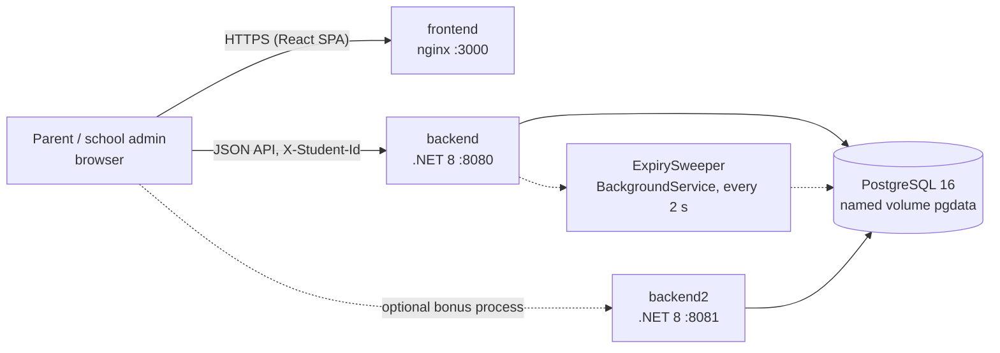
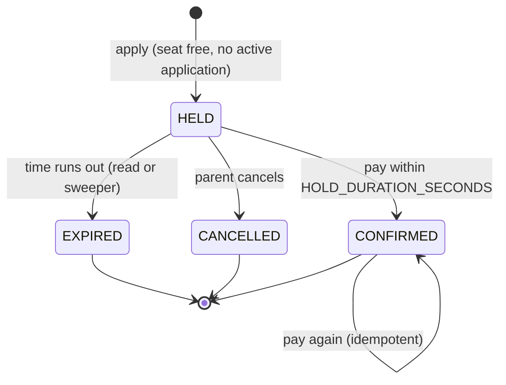
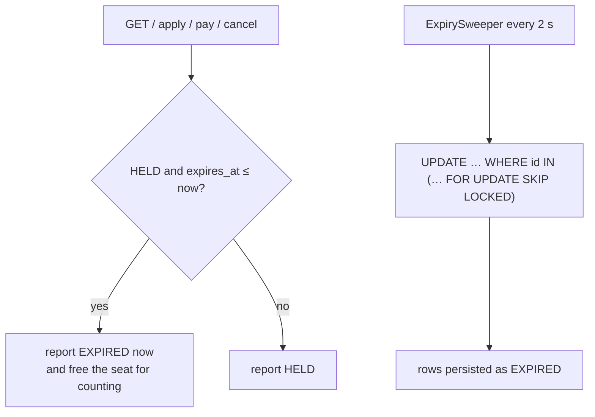

# Architecture

How the system is built, and why the seat limit holds even with many simultaneous requests and two API processes.

## Components



- The **frontend** is a static React app. nginx serves it and writes `config.js` at start-up so the same image works with any backend URL.
- The **backend** is one ASP.NET Core minimal-API project. All rules live in `AdmissionService`; the endpoints only validate input and map results.
- **PostgreSQL** is the single source of truth. Every rule that matters is enforced there, not just in C#.

## Hold lifecycle



- A seat is **occupied** while HELD or CONFIRMED. EXPIRED and CANCELLED seats return to the pool.
- Expiry is decided by the **database clock** (`clock_timestamp()`), never the app clock.

## Two parents race for the last seat

```mermaid
sequenceDiagram
  autonumber
  participant A as Parent A
  participant B as Parent B
  participant API as Backend (any process)
  participant DB as PostgreSQL
  A->>API: POST /classes/{id}/holds
  B->>API: POST /classes/{id}/holds
  API->>DB: BEGIN; SELECT class FOR UPDATE
  Note over DB: row lock taken by A's transaction
  API->>DB: BEGIN; SELECT class FOR UPDATE
  Note over API,DB: B's transaction waits on the row lock
  API->>DB: release overdue holds; count HELD+CONFIRMED (= total - 1)
  API->>DB: INSERT hold (A), COMMIT, lock released
  DB-->>API: B's lock granted
  API->>DB: release overdue holds; count HELD+CONFIRMED (= total)
  API-->>B: 409 SEATS_FULL
  API-->>A: 201 HELD
```

Because B's count runs only after A commits, B always sees the seat A took. Nothing about this depends on timing.

## Why the limit holds across two processes

- The lock is a **row lock in PostgreSQL**, not a lock in one C# process. Two API processes on different ports (`backend` on 8080 and `backend2` on 8081) queue on the same row.
- A **partial unique index** on `(class_id, student_id) WHERE status IN ('HELD','CONFIRMED')` is a second guard: one active application per student per class, even if the lock were ever skipped.
- `scripts/two-process-race.sh` checks this: 60 simultaneous holds across both processes give exactly 5 successes for 5 seats.

## How expiry works (two layers)



- **Reads are always right**, to the second, because counting ignores overdue HELD rows even before anything is written.
- **The sweeper** persists EXPIRED so the database and the API agree. It uses `SKIP LOCKED`, so it never waits on a row another request holds, which rules out a deadlock.

## Transaction and locking rules

| Operation | Lock order | Why |
|---|---|---|
| Apply | class row | serialise seat counting per class |
| Pay / cancel | class row, then hold row | same order as apply, so they can't deadlock |
| Sweeper | hold rows, skip any that are locked | never waits, so it can't join a deadlock |

## Where to look in the code

| Concern | File |
|---|---|
| Rules and locking | `backend/src/Admission.Api/Services/AdmissionService.cs` |
| Expiry sweeper | `backend/src/Admission.Api/Services/ExpirySweeper.cs` |
| Schema and constraints | `backend/src/Admission.Api/Data/AdmissionDbContext.cs`, `Data/Migrations/` |
| Input checks and errors | `backend/src/Admission.Api/Errors/` |
| Contract tests | `backend/tests/Admission.Tests/` (real PostgreSQL via Testcontainers) |
| Load test | `load/apply-burst.js`, results in `docs/LOAD_TEST.md` |
